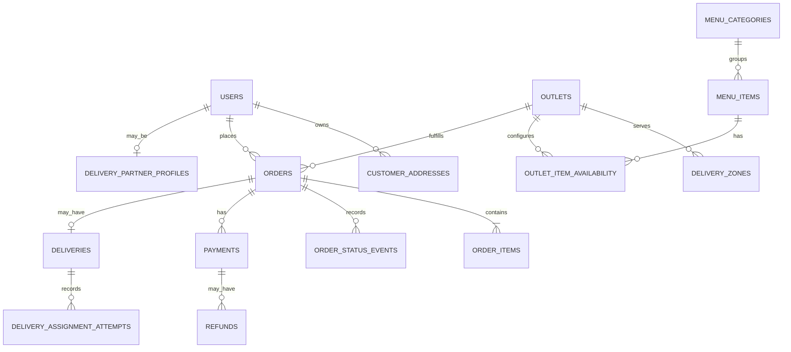

# Database Design

**Status:** Logical model draft; adapt to the selected database and ORM.

## 1. Design principles

- Use stable primary keys, foreign keys, constraints, and appropriate indexes.
- Store money using integer minor units (for example, paise) or a suitable fixed-precision decimal type; never binary floating point.
- Store timestamps consistently (UTC recommended) and render in the relevant local timezone.
- Snapshot purchased item names, modifiers, unit prices, taxes/fees, and delivery address on the order.
- Separate order status, payment status, and delivery assignment status.
- Use transactions and idempotency keys for critical workflows.
- Keep personally identifiable information access-controlled.

## 2. Core entities

| Entity | Key fields | Notes |
|---|---|---|
| users | id, name, phone, email, auth_reference, status, created_at | Avoid duplicate identity fields if an auth provider owns them |
| roles / user_roles | user_id, role, outlet_id nullable | Role and outlet scope |
| customer_addresses | id, customer_id, address fields, coordinates nullable | Restrict access; coordinates only if required |
| outlets | id, name, address, coordinates, timezone, status | Chain-owned outlets |
| outlet_hours | id, outlet_id, weekday, open_time, close_time | Support exceptions/holidays separately if needed |
| delivery_zones | id, outlet_id, zone_type, zone_data, fee_minor, active | Define zone representation explicitly |
| menu_categories | id, name, display_order, active | Chain or outlet scope must be decided |
| menu_items | id, category_id, name, description, base_price_minor, active | Base menu data |
| modifier_groups | id, name, min_select, max_select, required | Validation rules |
| modifier_options | id, group_id, name, price_delta_minor, active | Price delta |
| item_modifier_groups | item_id, modifier_group_id | Many-to-many mapping if needed |
| outlet_item_availability | outlet_id, item_id, available, price_override_minor nullable | Optional outlet-specific overrides |
| carts | id, customer_id/session_id, outlet_id, updated_at | One outlet per cart |
| cart_items | id, cart_id, item_id, quantity, instructions | Store selected modifiers in normalized rows or validated JSON |
| cart_item_modifiers | cart_item_id, modifier_option_id, quantity | Prefer normalized rows for relational integrity |
| orders | id, order_number, customer_id, outlet_id, status, totals, address_snapshot, idempotency_key, timestamps | Snapshot and audit carefully |
| order_items | id, order_id, item_id nullable, item_name_snapshot, quantity, unit_price_minor, line_total_minor | Item may later be deactivated/deleted |
| order_item_modifiers | id, order_item_id, name_snapshot, price_delta_minor, quantity | Preserve historical modifier details |
| order_status_events | id, order_id, old_status, new_status, actor_id, reason, created_at | Append-only audit history |
| payments | id, order_id, provider, provider_reference, amount_minor, status, method, timestamps | Unique provider reference where available |
| refunds | id, payment_id, provider_reference, amount_minor, status, reason, timestamps | Provider-confirmed outcomes |
| delivery_partner_profiles | user_id, availability, service_zone/config, status | Avoid storing unnecessary location history |
| deliveries | id, order_id, status, assigned_partner_id nullable, timestamps | One delivery record per order unless split delivery is explicitly supported |
| delivery_assignment_attempts | id, delivery_id, partner_id, outcome, reason, offered_at, responded_at | Audit retries and assignment decisions |
| notifications | id, recipient_id, order_id, channel, status, attempt_count, timestamps | Track delivery, not message secrets |
| audit_logs | id, actor_id, action, resource_type, resource_id, metadata, created_at | Exclude secrets and unnecessary personal data |
| idempotency_records | key, actor_id, operation, request_hash, response_reference, expires_at | Scope keys to actor/operation |

## 3. Relationships

The diagram is conceptual. Cardinality and table names should be aligned with the implementation and any payment provider requirements.

## 4. Important constraints

- Unique order number.
- Unique idempotency key per actor/operation scope.
- Unique provider transaction reference where provided.
- Quantity must be a positive integer and within configured limits.
- Monetary values must be non-negative unless a documented adjustment model requires otherwise.
- Foreign keys should protect relationships without making historical order snapshots dependent on active menu records.
- At most one active assignment per delivery; implement using a database-supported partial unique index or a transactional reservation strategy.
- Valid state transitions must be enforced in application logic and tested.
- Use optimistic concurrency/version checks if simultaneous staff/partner updates are possible.

## 5. Index recommendations

Validate with query plans, but likely candidates include:
- `orders(order_number)` unique.
- `orders(customer_id, created_at DESC)`.
- `orders(outlet_id, status, created_at)`.
- `order_status_events(order_id, created_at)`.
- `payments(provider, provider_reference)` unique when reference is non-null.
- `deliveries(assigned_partner_id, status)`.
- `delivery_assignment_attempts(delivery_id, offered_at)`.
- `menu_items(category_id, active)`.
- `notifications(status, created_at)` for retry workers.

## 6. Migrations and seeds

- All schema changes must be versioned migrations.
- Never use destructive production resets as a routine deployment step.
- Seed only clearly synthetic menu/customer data in development.
- Keep migration and rollback notes with each meaningful schema change.
- Test migrations on a copy or staging database before production.
- Avoid using real customer or payment data in development fixtures.

## 7. Decisions to finalize

- UUID vs integer primary keys.
- Normalized modifier rows vs validated JSON snapshots.
- One cart per user vs multiple saved carts.
- Whether an order can contain scheduled items or multiple deliveries.
- Geographic zone representation.
- Audit log retention and personal-data deletion strategy.

