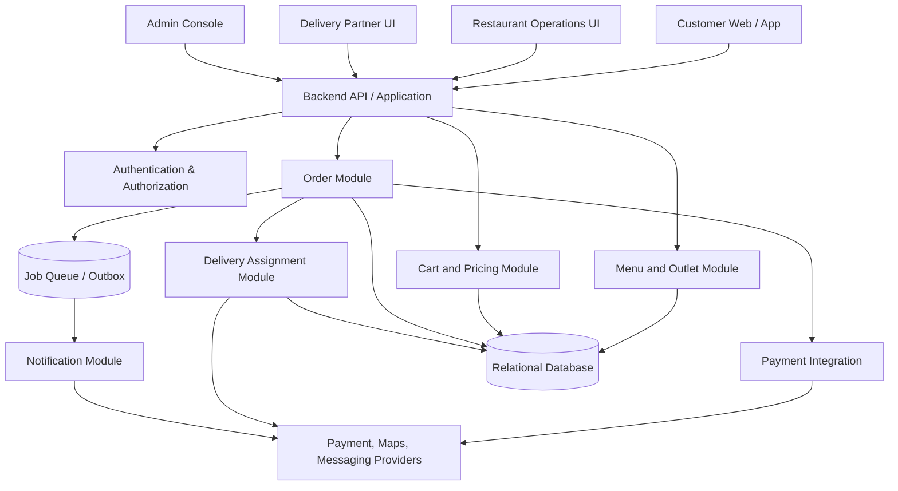

# System Architecture

**Status:** Technology-neutral reference architecture; stack selection is TBD.

## 1. Architectural goals

- Keep customer, restaurant, partner, and admin experiences separate by permissions.
- Centralize business rules on the server.
- Prevent duplicate orders, payment effects, and delivery assignments.
- Support one chain with one or more outlets.
- Make order state and operational events observable.
- Start with a maintainable MVP and avoid premature microservices.

## 2. Recommended starting shape

Use a modular monolith unless expected scale, team ownership, or operational constraints justify separate services. A modular monolith keeps deployment and transactions simpler while preserving domain boundaries.

## 3. Logical modules

### Identity and access
Authentication, sessions, role-based authorization, outlet scoping, account status, and audit actor identity.

### Chain and outlet
Restaurant-chain configuration, outlets, opening hours, delivery coverage, operating capacity, and outlet selection.

### Menu
Categories, items, modifier groups/options, availability, outlet-specific price or availability overrides.

### Cart and pricing
Cart validation, modifier rules, authoritative price calculation, taxes, fees, discounts, and checkout quote.

### Orders
Order creation, order-item snapshots, order state transitions, cancellations, history, and status events.

### Payments
Provider integration, payment intents/transactions, verified webhooks, idempotency, refund status, and reconciliation.

### Delivery
Partner profiles, availability, assignment attempts, atomic assignment reservation, pickup, completion, failed delivery, and manual reassignment.

### Notifications
Transactional notifications triggered by committed business events, retry handling, and delivery status logging.

### Administration and reporting
Menu and outlet management, order search, role management, basic operational metrics, and audit logs.

## 4. Critical workflows

### Order placement
1. Client submits cart reference or items, address, payment method, and idempotency key.
2. Server authenticates the user and validates address, outlet, item availability, modifiers, and current prices.
3. Server calculates the authoritative total.
4. Server creates an order/payment attempt using a transaction-safe workflow.
5. Payment outcome is confirmed through the approved provider flow.
6. Customer receives the current order and payment state.
7. Notifications are emitted from committed events, ideally through an outbox/job pattern.

The exact ordering of payment authorization and order finalization depends on the selected payment provider. Define recovery behavior before implementation.

### Delivery assignment
1. An order becomes eligible for delivery under the business rules.
2. System finds eligible partners.
3. Assignment service offers or assigns a job using configured ranking rules.
4. Database constraints/transaction prevent multiple active assignments.
5. Expired or declined offers are recorded and retried safely.
6. If no partner can be assigned, operations staff see an alert and queue item.

### Status update
1. Actor requests a transition.
2. Server verifies actor, outlet/order scope, and permitted transition.
3. Server persists state change and audit event in one transaction.
4. Notification/event processing occurs after commit.
5. Customer tracking reads the committed status and timestamp.

## 5. Data and transaction boundaries

- Use a relational database for orders, payments, menus, and assignment records unless a documented reason supports an alternative.
- Use transactions for order creation, order-state transitions, and assignment reservation.
- Use unique constraints for order numbers, idempotency keys, provider transaction references, and one-active-assignment invariants where practical.
- Treat third-party services as unreliable; use timeouts, retries with limits, idempotency, and reconciliation.
- Do not hold a database transaction open while waiting on a long external network request.
- Consider an outbox pattern for reliable publication of notifications and domain events.

## 6. Real-time tracking

MVP can use polling or server-sent events/websockets for status updates, based on the selected stack and expected load. Live partner GPS is optional and requires explicit permission, secure handling, and a location retention policy.

Do not show a precise map or ETA unless the relevant data and provider integration exist.

## 7. Deployment environments

- Local development: safe sample data and provider sandboxes.
- CI: automated tests, lint, type-check, security/dependency checks.
- Staging: production-like configuration with sandbox payment credentials.
- Production: restricted access, managed secrets, backups, monitoring, and documented rollback.

## 8. Architecture decisions still required

- Web/PWA vs native app.
- Framework and language.
- Database and hosting.
- Authentication strategy.
- Payment provider and payment lifecycle.
- Notification provider.
- Maps/geocoding provider.
- Polling vs push-style updates.
- Queue/outbox implementation.
- Initial traffic and availability target.

Record final decisions in `docs/10-decisions/ADR/`.
