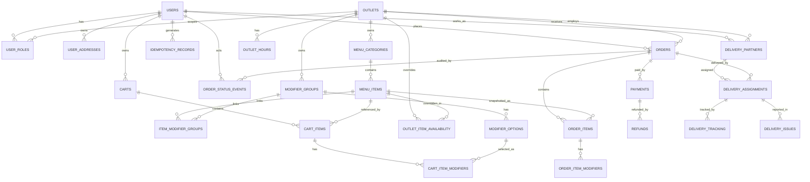

# Database Design

## ER Diagram (Mermaid)



## Table Definitions

### Core Tables (V1 - Baseline)

#### `users`
| Column | Type | Constraints | Description |
|--------|------|-------------|-------------|
| id | BIGINT | PK, AI | Unique identifier |
| email | VARCHAR(255) | NN, UNIQUE | Login email |
| password | VARCHAR(255) | NN | BCrypt hash |
| name | VARCHAR(150) | NN | Display name |
| phone | VARCHAR(20) | NULL | Contact number |
| status | VARCHAR(20) | NN, DEFAULT 'ACTIVE' | ACTIVE/INACTIVE |
| created_at | TIMESTAMP | NN, DEFAULT CURRENT_TIMESTAMP | |
| updated_at | TIMESTAMP | NN, DEFAULT CURRENT_TIMESTAMP ON UPDATE | |

#### `user_roles`
| Column | Type | Constraints | Description |
|--------|------|-------------|-------------|
| id | BIGINT | PK, AI | |
| user_id | BIGINT | NN, FK → users(id) CASCADE | |
| role | VARCHAR(30) | NN | ADMIN, USER, OUTLET_STAFF, DELIVERY_GUY |
| outlet_id | BIGINT | NULL, FK → outlets(id) SET NULL | Scopes staff roles |
| created_at | TIMESTAMP | NN, DEFAULT CURRENT_TIMESTAMP | |
| **Unique** | | (user_id, role, outlet_id) | |

#### `outlets`
| Column | Type | Constraints | Description |
|--------|------|-------------|-------------|
| id | BIGINT | PK, AI | |
| name | VARCHAR(200) | NN | |
| address | TEXT | NN | |
| city | VARCHAR(100) | NULL | |
| state | VARCHAR(100) | NULL | |
| pincode | VARCHAR(10) | NULL | |
| latitude | DECIMAL(10,7) | NULL | |
| longitude | DECIMAL(10,7) | NULL | |
| timezone | VARCHAR(50) | NN, DEFAULT 'Asia/Kolkata' | |
| phone | VARCHAR(20) | NULL | |
| status | VARCHAR(20) | NN, DEFAULT 'ACTIVE' | |
| created_at | TIMESTAMP | NN, DEFAULT CURRENT_TIMESTAMP | |
| updated_at | TIMESTAMP | NN, DEFAULT CURRENT_TIMESTAMP ON UPDATE | |

#### `outlet_hours`
| Column | Type | Constraints | Description |
|--------|------|-------------|-------------|
| id | BIGINT | PK, AI | |
| outlet_id | BIGINT | NN, FK → outlets(id) CASCADE | |
| weekday | TINYINT | NN, CHECK 0-6 | 0=Mon...6=Sun |
| open_time | TIME | NN | |
| close_time | TIME | NN | CHECK open < close |
| **Unique** | | (outlet_id, weekday) | |

### Menu Tables (V3, V9)

#### `menu_categories`
| Column | Type | Constraints | Description |
|--------|------|-------------|-------------|
| id | BIGINT | PK, AI | |
| outlet_id | BIGINT | NULL, FK → outlets(id) SET NULL | NULL = chain-wide |
| name | VARCHAR(100) | NN | |
| description | TEXT | NULL | |
| display_order | INT | NN, DEFAULT 0 | Sort order |
| active | BOOLEAN | NN, DEFAULT TRUE | |
| created_at | TIMESTAMP | NN, DEFAULT CURRENT_TIMESTAMP | |
| updated_at | TIMESTAMP | NN, DEFAULT CURRENT_TIMESTAMP ON UPDATE | |

#### `menu_items`
| Column | Type | Constraints | Description |
|--------|------|-------------|-------------|
| id | BIGINT | PK, AI | |
| category_id | BIGINT | NN, FK → menu_categories(id) CASCADE | |
| name | VARCHAR(150) | NN | |
| description | TEXT | NULL | |
| base_price_minor | INT | NN, CHECK >= 0 | Price in paise |
| image_url | VARCHAR(500) | NULL | From V9 |
| dietary_type | VARCHAR(20) | NULL | veg/non_veg (from V9) |
| active | BOOLEAN | NN, DEFAULT TRUE | |
| available | BOOLEAN | NN, DEFAULT TRUE | |
| created_at | TIMESTAMP | NN, DEFAULT CURRENT_TIMESTAMP | |
| updated_at | TIMESTAMP | NN, DEFAULT CURRENT_TIMESTAMP ON UPDATE | |
| **Index** | | (category_id, active) | |

#### `modifier_groups`
| Column | Type | Constraints | Description |
|--------|------|-------------|-------------|
| id | BIGINT | PK, AI | |
| outlet_id | BIGINT | NULL, FK → outlets(id) SET NULL | |
| name | VARCHAR(100) | NN | e.g., "Spice Level" |
| min_select | INT | NN, DEFAULT 0 | |
| max_select | INT | NN, DEFAULT 0 | 0 = unlimited |
| required | BOOLEAN | NN, DEFAULT FALSE | |
| active | BOOLEAN | NN, DEFAULT TRUE | |
| created_at | TIMESTAMP | NN, DEFAULT CURRENT_TIMESTAMP | |
| updated_at | TIMESTAMP | NN, DEFAULT CURRENT_TIMESTAMP ON UPDATE | |
| **Check** | | min_select <= max_select | |

#### `modifier_options`
| Column | Type | Constraints | Description |
|--------|------|-------------|-------------|
| id | BIGINT | PK, AI | |
| group_id | BIGINT | NN, FK → modifier_groups(id) CASCADE | |
| name | VARCHAR(100) | NN | e.g., "Medium" |
| price_delta_minor | INT | NN, DEFAULT 0, CHECK >= 0 | Extra charge |
| active | BOOLEAN | NN, DEFAULT TRUE | |
| created_at | TIMESTAMP | NN, DEFAULT CURRENT_TIMESTAMP | |
| updated_at | TIMESTAMP | NN, DEFAULT CURRENT_TIMESTAMP ON UPDATE | |
| **Index** | | (group_id, active) | |

#### `item_modifier_groups` (Many-to-Many)
| Column | Type | Constraints | Description |
|--------|------|-------------|-------------|
| item_id | BIGINT | PK, FK → menu_items(id) CASCADE | |
| modifier_group_id | BIGINT | PK, FK → modifier_groups(id) CASCADE | |

#### `outlet_item_availability` (Composite PK)
| Column | Type | Constraints | Description |
|--------|------|-------------|-------------|
| outlet_id | BIGINT | PK, FK → outlets(id) CASCADE | |
| item_id | BIGINT | PK, FK → menu_items(id) CASCADE | |
| available | BOOLEAN | NN, DEFAULT TRUE | |
| price_override_minor | INT | NULL, CHECK >= 0 | Outlet-specific price |

### Cart Tables (V4)

#### `carts`
| Column | Type | Constraints | Description |
|--------|------|-------------|-------------|
| id | BIGINT | PK, AI | |
| customer_id | BIGINT | NN, FK → users(id) CASCADE | |
| outlet_id | BIGINT | NULL, FK → outlets(id) SET NULL | One outlet per cart |
| updated_at | TIMESTAMP | NN, DEFAULT CURRENT_TIMESTAMP ON UPDATE | |
| **Unique Index** | | (customer_id) | One cart per user |

#### `cart_items`
| Column | Type | Constraints | Description |
|--------|------|-------------|-------------|
| id | BIGINT | PK, AI | |
| cart_id | BIGINT | NN, FK → carts(id) CASCADE | |
| item_id | BIGINT | NN, FK → menu_items(id) | No cascade - item may be deleted |
| quantity | INT | NN, DEFAULT 1, CHECK > 0 | |
| instructions | VARCHAR(255) | NULL | Special requests |
| created_at | TIMESTAMP | NN, DEFAULT CURRENT_TIMESTAMP | |
| updated_at | TIMESTAMP | NN, DEFAULT CURRENT_TIMESTAMP ON UPDATE | |
| **Index** | | (cart_id) | |

#### `cart_item_modifiers`
| Column | Type | Constraints | Description |
|--------|------|-------------|-------------|
| id | BIGINT | PK, AI | |
| cart_item_id | BIGINT | NN, FK → cart_items(id) CASCADE | |
| modifier_option_id | BIGINT | NN, FK → modifier_options(id) | |
| quantity | INT | NN, DEFAULT 1, CHECK > 0 | |
| **Unique** | | (cart_item_id, modifier_option_id) | No duplicates |

### Order Tables (V6)

#### `orders`
| Column | Type | Constraints | Description |
|--------|------|-------------|-------------|
| id | BIGINT | PK, AI | |
| order_number | VARCHAR(32) | NN, UNIQUE | Human-readable: ORD-20241025-001 |
| customer_id | BIGINT | NN, FK → users(id) | |
| outlet_id | BIGINT | NN, FK → outlets(id) | |
| status | VARCHAR(30) | NN, DEFAULT 'PLACED' | State machine |
| subtotal_minor | INT | NN, DEFAULT 0, CHECK >= 0 | Items only |
| tax_minor | INT | NN, DEFAULT 0 | 5% of subtotal |
| delivery_fee_minor | INT | NN, DEFAULT 0 | |
| grand_total_minor | INT | NN, DEFAULT 0, CHECK >= 0 | Final amount |
| delivery_address_json | JSON | NN | Full address snapshot |
| idempotency_key | VARCHAR(128) | NULL, UNIQUE | Client-generated |
| created_at | TIMESTAMP | NN, DEFAULT CURRENT_TIMESTAMP | |
| updated_at | TIMESTAMP | NN, DEFAULT CURRENT_TIMESTAMP ON UPDATE | |
| **Indexes** | | (customer_id, created_at DESC), (outlet_id, status, created_at DESC), (idempotency_key) | |

#### `order_items`
| Column | Type | Constraints | Description |
|--------|------|-------------|-------------|
| id | BIGINT | PK, AI | |
| order_id | BIGINT | NN, FK → orders(id) CASCADE | |
| item_id | BIGINT | NULL, FK → menu_items(id) SET NULL | Snapshot if item deleted |
| item_name_snapshot | VARCHAR(200) | NN | Name at order time |
| quantity | INT | NN, DEFAULT 1, CHECK > 0 | |
| unit_price_minor | INT | NN, CHECK >= 0 | Price at order time |
| line_total_minor | INT | NN, CHECK >= 0 | unit * quantity |
| instructions | VARCHAR(255) | NULL | |
| **Index** | | (order_id) | |

#### `order_item_modifiers`
| Column | Type | Constraints | Description |
|--------|------|-------------|-------------|
| id | BIGINT | PK, AI | |
| order_item_id | BIGINT | NN, FK → order_items(id) CASCADE | |
| name_snapshot | VARCHAR(100) | NN | Modifier name at order time |
| price_delta_minor | INT | NN, DEFAULT 0, CHECK >= 0 | |
| quantity | INT | NN, DEFAULT 1, CHECK > 0 | |
| **Index** | | (order_item_id) | |

#### `order_status_events` (Audit Log)
| Column | Type | Constraints | Description |
|--------|------|-------------|-------------|
| id | BIGINT | PK, AI | |
| order_id | BIGINT | NN, FK → orders(id) CASCADE | |
| old_status | VARCHAR(30) | NULL | NULL for initial |
| new_status | VARCHAR(30) | NN | |
| actor_id | BIGINT | NULL, FK → users(id) SET NULL | Who triggered |
| actor_role | VARCHAR(30) | NULL | ADMIN, USER, etc. |
| reason | VARCHAR(255) | NULL | Cancellation reason etc. |
| created_at | TIMESTAMP | NN, DEFAULT CURRENT_TIMESTAMP | |
| **Index** | | (order_id, created_at) | |

#### `payments`
| Column | Type | Constraints | Description |
|--------|------|-------------|-------------|
| id | BIGINT | PK, AI | |
| order_id | BIGINT | NULL, FK → orders(id) CASCADE | |
| provider | VARCHAR(30) | NN, DEFAULT 'razorpay' | |
| provider_reference | VARCHAR(128) | NULL | Razorpay payment_id |
| amount_minor | INT | NN, CHECK >= 0 | |
| status | VARCHAR(30) | NN, DEFAULT 'PENDING' | PENDING/CAPTURED/FAILED/REFUNDED |
| method | VARCHAR(50) | NULL | card/upi/netbanking/wallet |
| created_at | TIMESTAMP | NN, DEFAULT CURRENT_TIMESTAMP | |
| updated_at | TIMESTAMP | NN, DEFAULT CURRENT_TIMESTAMP ON UPDATE | |
| **Unique** | | (provider, provider_reference) | |
| **Indexes** | | (order_id), (status) | |

#### `refunds`
| Column | Type | Constraints | Description |
|--------|------|-------------|-------------|
| id | BIGINT | PK, AI | |
| payment_id | BIGINT | NN, FK → payments(id) CASCADE | |
| provider_reference | VARCHAR(128) | NULL | Razorpay refund_id |
| amount_minor | INT | NN, CHECK >= 0 | |
| status | VARCHAR(30) | NN, DEFAULT 'PENDING' | |
| reason | VARCHAR(255) | NULL | |
| created_at | TIMESTAMP | NN, DEFAULT CURRENT_TIMESTAMP | |
| updated_at | TIMESTAMP | NN, DEFAULT CURRENT_TIMESTAMP ON UPDATE | |

#### `idempotency_records`
| Column | Type | Constraints | Description |
|--------|------|-------------|-------------|
| record_key | VARCHAR(128) | PK | Client idempotency key |
| actor_id | BIGINT | NULL, FK → users(id) SET NULL | |
| operation | VARCHAR(60) | NN | e.g., "CREATE_ORDER" |
| request_hash | VARCHAR(128) | NN | SHA-256 of request body |
| response_status | INT | NULL | HTTP status |
| response_body | JSON | NULL | Cached response |
| created_at | TIMESTAMP | NN, DEFAULT CURRENT_TIMESTAMP | |
| expires_at | TIMESTAMP | NULL | 24h TTL |
| **Index** | | (expires_at) | Cleanup |

### Delivery Tables (V7)

#### `delivery_partners`
| Column | Type | Constraints | Description |
|--------|------|-------------|-------------|
| id | BIGINT | PK, AI | |
| user_id | BIGINT | NN, UNIQUE, FK → users(id) CASCADE | 1:1 with user |
| outlet_id | BIGINT | NULL, FK → outlets(id) SET NULL | Home outlet |
| vehicle_type | VARCHAR(20) | NULL | bike/scooter/cycle |
| vehicle_number | VARCHAR(20) | NULL | |
| license_number | VARCHAR(30) | NULL | |
| status | VARCHAR(20) | NN, DEFAULT 'OFFLINE' | ONLINE/OFFLINE/BUSY |
| current_latitude | DECIMAL(10,7) | NULL | |
| current_longitude | DECIMAL(10,7) | NULL | |
| last_location_update | TIMESTAMP | NULL | |
| created_at | TIMESTAMP | NN, DEFAULT CURRENT_TIMESTAMP | |
| updated_at | TIMESTAMP | NN, DEFAULT CURRENT_TIMESTAMP ON UPDATE | |

#### `delivery_assignments`
| Column | Type | Constraints | Description |
|--------|------|-------------|-------------|
| id | BIGINT | PK, AI | |
| order_id | BIGINT | NN, UNIQUE, FK → orders(id) CASCADE | 1:1 with order |
| partner_id | BIGINT | NN, FK → delivery_partners(id) | |
| status | VARCHAR(30) | NN, DEFAULT 'OFFERED' | OFFERED/ACCEPTED/PICKED_UP/DELIVERED/CANCELLED |
| assigned_at | TIMESTAMP | NN, DEFAULT CURRENT_TIMESTAMP | |
| accepted_at | TIMESTAMP | NULL | |
| picked_up_at | TIMESTAMP | NULL | |
| delivered_at | TIMESTAMP | NULL | |
| created_at | TIMESTAMP | NN, DEFAULT CURRENT_TIMESTAMP | |
| updated_at | TIMESTAMP | NN, DEFAULT CURRENT_TIMESTAMP ON UPDATE | |

#### `delivery_tracking`
| Column | Type | Constraints | Description |
|--------|------|-------------|-------------|
| id | BIGINT | PK, AI | |
| assignment_id | BIGINT | NN, FK → delivery_assignments(id) CASCADE | |
| latitude | DECIMAL(10,7) | NN | |
| longitude | DECIMAL(10,7) | NN | |
| recorded_at | TIMESTAMP | NN, DEFAULT CURRENT_TIMESTAMP | |

#### `delivery_issues`
| Column | Type | Constraints | Description |
|--------|------|-------------|-------------|
| id | BIGINT | PK, AI | |
| assignment_id | BIGINT | NN, FK → delivery_assignments(id) CASCADE | |
| reported_by_partner_id | BIGINT | NN, FK → delivery_partners(id) | |
| issue_type | VARCHAR(30) | NN | ADDRESS_NOT_FOUND/CUSTOMER_UNAVAILABLE/OTHER |
| description | TEXT | NULL | |
| resolved | BOOLEAN | NN, DEFAULT FALSE | |
| created_at | TIMESTAMP | NN, DEFAULT CURRENT_TIMESTAMP | |
| resolved_at | TIMESTAMP | NULL | |

### User Addresses (V8)

#### `user_addresses`
| Column | Type | Constraints | Description |
|--------|------|-------------|-------------|
| id | BIGINT | PK, AI | |
| user_id | BIGINT | NN, FK → users(id) CASCADE | |
| label | VARCHAR(50) | NN | Home/Work/Other |
| full_address | TEXT | NN | |
| city | VARCHAR(100) | NULL | |
| state | VARCHAR(100) | NULL | |
| pincode | VARCHAR(10) | NULL | |
| phone | VARCHAR(20) | NULL | |
| is_default | BOOLEAN | NN, DEFAULT FALSE | |
| latitude | DECIMAL(10,7) | NULL | |
| longitude | DECIMAL(10,7) | NULL | |
| created_at | TIMESTAMP | NN, DEFAULT CURRENT_TIMESTAMP | |
| updated_at | TIMESTAMP | NN, DEFAULT CURRENT_TIMESTAMP ON UPDATE | |
| **Index** | | (user_id) | |

## Key Relationships Summary

| Parent | Child | Type | On Delete |
|--------|-------|------|-----------|
| users | user_roles | 1:M | CASCADE |
| users | user_addresses | 1:M | CASCADE |
| users | carts | 1:1 | CASCADE |
| users | orders | 1:M | RESTRICT |
| outlets | menu_categories | 1:M | SET NULL |
| outlets | modifier_groups | 1:M | SET NULL |
| outlets | orders | 1:M | RESTRICT |
| menu_categories | menu_items | 1:M | CASCADE |
| menu_items | item_modifier_groups | M:M | CASCADE |
| modifier_groups | modifier_options | 1:M | CASCADE |
| carts | cart_items | 1:M | CASCADE |
| cart_items | cart_item_modifiers | 1:M | CASCADE |
| orders | order_items | 1:M | CASCADE |
| orders | order_status_events | 1:M | CASCADE |
| orders | payments | 1:M | CASCADE |
| orders | delivery_assignments | 1:1 | CASCADE |
| order_items | order_item_modifiers | 1:M | CASCADE |
| payments | refunds | 1:M | CASCADE |
| delivery_partners | delivery_assignments | 1:M | RESTRICT |
| delivery_assignments | delivery_tracking | 1:M | CASCADE |
| delivery_assignments | delivery_issues | 1:M | CASCADE |

## Migration Strategy

### Applied Migrations (in order)
```bash
mvn flyway:migrate
```
1. V1: Baseline schema (users, roles, outlets, hours)
2. V2: Seed dev data (1 outlet, 3 users with roles)
3. V3: Menu schema (categories, items, modifiers, availability)
4. V4: Cart schema (carts, items, item modifiers)
5. V5: Seed menu data (7 categories, 50 items)
6. V6: Order schema (orders, items, payments, idempotency)
7. V7: Delivery schema (partners, assignments, tracking, issues)
8. V8: User addresses schema
9. V9: Menu item images + dietary types (ALTER + seed)

### Verification Commands
```bash
# Check status
mvn flyway:info

# Validate checksums
mvn flyway:validate

# Clean and re-apply (dev only)
mvn flyway:clean flyway:migrate

# Repair failed migration
mvn flyway:repair
```

## Common Queries

### Menu with Availability (Outlet 1)
```sql
SELECT 
    mc.name AS category,
    mi.name AS item,
    mi.base_price_minor,
    mi.image_url,
    mi.dietary_type,
    COALESCE(oia.available, mi.available) AS available,
    COALESCE(oia.price_override_minor, mi.base_price_minor) AS effective_price
FROM menu_categories mc
JOIN menu_items mi ON mi.category_id = mc.id
LEFT JOIN outlet_item_availability oia 
    ON oia.item_id = mi.id AND oia.outlet_id = 1
WHERE mc.active = TRUE 
  AND mi.active = TRUE
  AND mc.outlet_id = 1
ORDER BY mc.display_order, mi.name;
```

### Order with Items and Modifiers
```sql
SELECT 
    o.order_number,
    o.status,
    o.grand_total_minor,
    oi.item_name_snapshot,
    oi.quantity,
    oi.unit_price_minor,
    oi.line_total_minor,
    oim.name_snapshot AS modifier,
    oim.price_delta_minor,
    oim.quantity AS mod_qty
FROM orders o
JOIN order_items oi ON oi.order_id = o.id
LEFT JOIN order_item_modifiers oim ON oim.order_item_id = oi.id
WHERE o.customer_id = 3
ORDER BY o.created_at DESC, oi.id, oim.id;
```

### Delivery Partner Earnings
```sql
SELECT 
    dp.id,
    u.name,
    COUNT(da.id) AS deliveries,
    SUM(p.amount_minor) / 100 AS total_revenue_inr
FROM delivery_partners dp
JOIN users u ON u.id = dp.user_id
JOIN delivery_assignments da ON da.partner_id = dp.id
JOIN orders o ON o.id = da.order_id
JOIN payments p ON p.order_id = o.id
WHERE da.status = 'DELIVERED'
  AND p.status = 'CAPTURED'
GROUP BY dp.id, u.name;
```

## Indexes Summary

| Table | Indexes |
|-------|---------|
| users | PK(id), UK(email) |
| user_roles | PK(id), UK(user_id, role, outlet_id), FK(user_id), FK(outlet_id) |
| outlets | PK(id) |
| outlet_hours | PK(id), UK(outlet_id, weekday), FK(outlet_id) |
| menu_categories | PK(id), FK(outlet_id) |
| menu_items | PK(id), FK(category_id), IDX(category_id, active) |
| modifier_groups | PK(id), FK(outlet_id) |
| modifier_options | PK(id), FK(group_id), IDX(group_id, active) |
| item_modifier_groups | PK(item_id, modifier_group_id), FKs |
| outlet_item_availability | PK(outlet_id, item_id), FKs |
| carts | PK(id), UK(customer_id), FK(customer_id), FK(outlet_id) |
| cart_items | PK(id), FK(cart_id), FK(item_id), IDX(cart_id) |
| cart_item_modifiers | PK(id), FK(cart_item_id), FK(modifier_option_id), UK(cart_item_id, modifier_option_id) |
| orders | PK(id), UK(order_number), UK(idempotency_key), FK(customer_id), FK(outlet_id), IDX(customer_id, created_at), IDX(outlet_id, status, created_at), IDX(idempotency_key) |
| order_items | PK(id), FK(order_id), FK(item_id), IDX(order_id) |
| order_item_modifiers | PK(id), FK(order_item_id), IDX(order_item_id) |
| order_status_events | PK(id), FK(order_id), FK(actor_id), IDX(order_id, created_at) |
| payments | PK(id), FK(order_id), UK(provider, provider_reference), IDX(order_id), IDX(status) |
| refunds | PK(id), FK(payment_id) |
| idempotency_records | PK(record_key), FK(actor_id), IDX(expires_at) |
| delivery_partners | PK(id), UK(user_id), FK(user_id), FK(outlet_id) |
| delivery_assignments | PK(id), UK(order_id), FK(order_id), FK(partner_id) |
| delivery_tracking | PK(id), FK(assignment_id) |
| delivery_issues | PK(id), FK(assignment_id), FK(reported_by_partner_id) |
| user_addresses | PK(id), FK(user_id), IDX(user_id) |

## Constraints Summary

| Type | Count | Tables |
|------|-------|--------|
| Primary Keys | 22 | All tables |
| Foreign Keys | 32 | All relationships |
| Unique Constraints | 8 | email, order_number, idempotency_key, user_role_outlet, outlet_weekday, payment_ref, outlet_item, cart_customer |
| Check Constraints | 12 | Prices >= 0, quantities > 0, weekday 0-6, hours order, min<=max |
| Indexes | 25 | FK columns, query patterns |

## Data Integrity Rules

1. **Referential Integrity** - All FKs enforced, CASCADE/SET NULL/RESTRICT per relationship
2. **Price Integrity** - All monetary columns `CHECK >= 0`
3. **Quantity Integrity** - All quantity columns `CHECK > 0`
4. **Unique Business Keys** - Email, order_number, idempotency_key
5. **Soft Deletes** - `active`/`status` columns instead of DELETE
6. **Audit Trail** - `created_at`/`updated_at` on all tables, `order_status_events` for orders
7. **Idempotency** - `idempotency_records` with TTL cleanup
8. **Snapshot Pattern** - Order items store name/price at order time