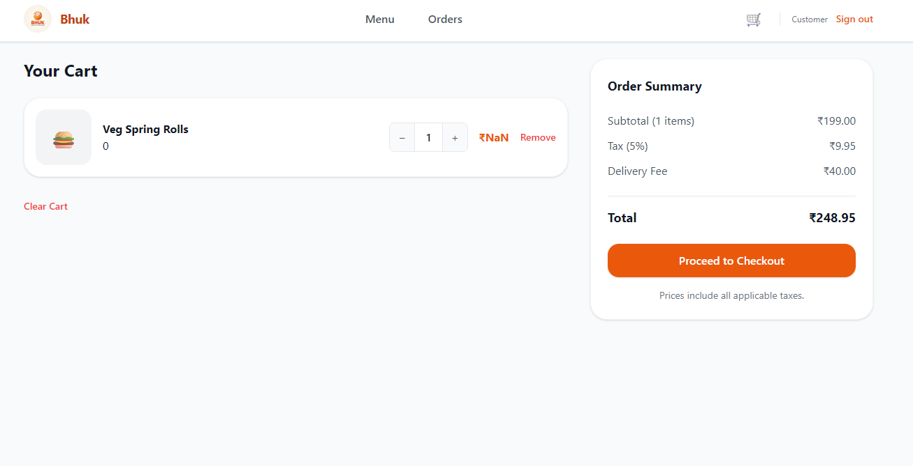
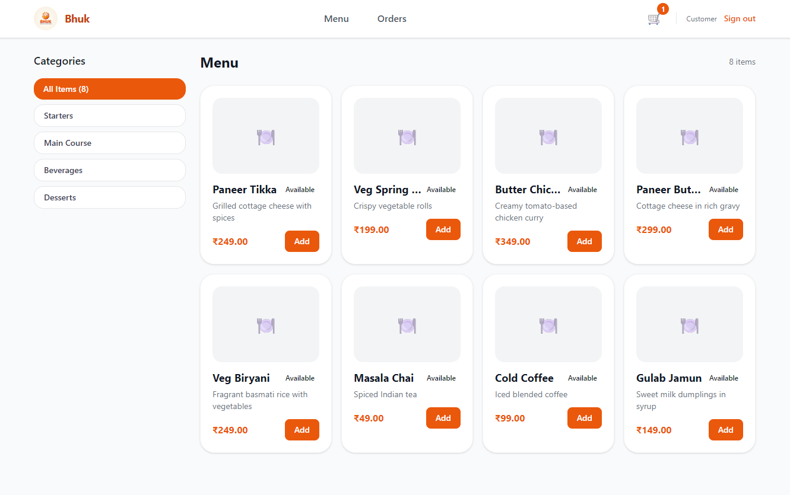
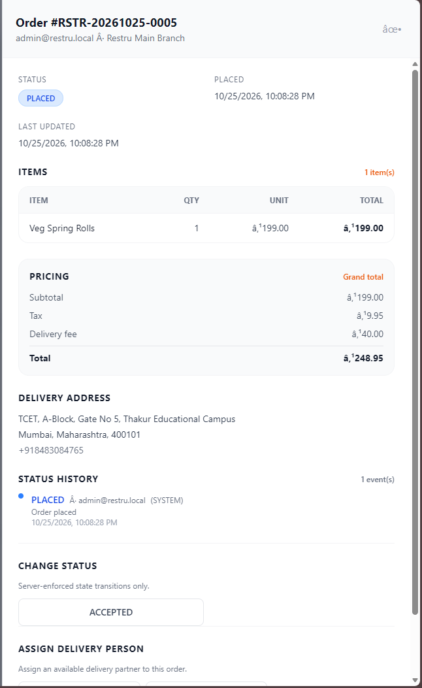
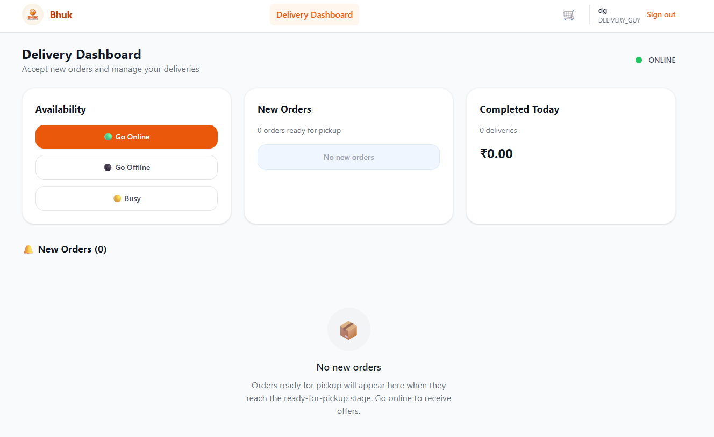
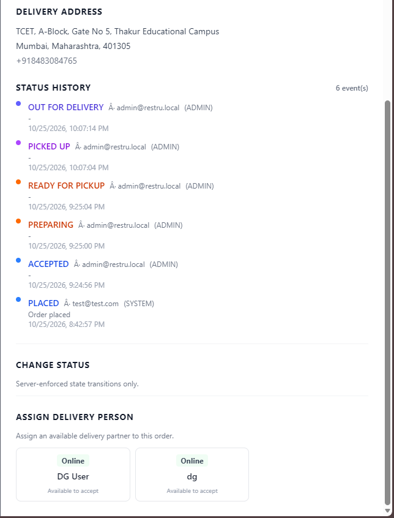

# Bhuk


**Bhuk** — your neighbourhood restaurant, delivered to your door.

A single-chain food delivery system built with Spring Boot and React. It covers customer ordering, restaurant order processing, delivery partner assignment, real-time order tracking, and administrative management.

## Table of Contents

- [Features](#features)
- [Tech Stack](#tech-stack)
- [Project Structure](#project-structure)
- [Prerequisites](#prerequisites)
- [Getting Started](#getting-started)
- [Environment Variables](#environment-variables)
- [Available Scripts](#available-scripts)
- [API Documentation](#api-documentation)
- [Testing](#testing)
- [Contributing](#contributing)
- [License](#license)

## Features

- **Customer Experience**: Browse menu, customize items, manage cart, checkout with delivery address validation, and track orders in real-time
- **Restaurant Operations**: Staff dashboard for order queue management, accept/reject orders, and update preparation status
- **Delivery Management**: Delivery partner dashboard for availability, order assignments, pickup/delivery updates, and issue reporting
- **Admin Panel**: Manage menu, outlets, users/roles, orders, and system configuration
- **Order Lifecycle**: Full order state machine (Placed → Accepted → Preparing → Ready for Pickup → Picked Up → Out for Delivery → Delivered)
- **Payment Integration**: Razorpay integration with webhook support and idempotent order creation
- **Role-Based Access Control**: Secure endpoints with JWT authentication and role-based authorization

## Screenshots



Customer cart page — browse the menu, review your cart, and proceed to checkout.



Main customer dashboard — browse the menu, track orders, and manage your account.



Admin order tracking — monitor order status changes and delivery assignments from the admin panel.



Delivery partner dashboard — go online, accept deliveries, and update pickup and delivery status.



Order lifecycle view — status changes and delivery assignment in real time.

## Tech Stack

### Backend
- **Framework**: [Spring Boot 3.2.5](https://spring.io/projects/spring-boot)
- **Language**: Java 17
- **Database**: MySQL with [Flyway](https://flywaydb.org/) migrations
- **Security**: Spring Security + JWT (jjwt)
- **Build Tool**: Maven

### Frontend
- **Framework**: [React 19](https://react.dev/) + [TypeScript](https://www.typescriptlang.org/)
- **Build Tool**: [Vite](https://vitejs.dev/)
- **Routing**: [React Router DOM](https://reactrouter.com/)
- **Styling**: [Tailwind CSS v4](https://tailwindcss.com/)
- **HTTP Client**: [Axios](https://axios-http.com/)
- **Linting**: [oxlint](https://oxc.rs/)

## Project Structure

```
restru/
├── backend/          # Spring Boot REST API
│   ├── src/main/     # Application source code
│   └── src/test/     # Backend tests
├── frontend/         # React + Vite web application
│   └── src/          # Frontend source code
├── docs/             # Project documentation (SRS, API spec, architecture, etc.)
├── run.ps1           # Script to start both backend and frontend
└── .env.example      # Environment variables template
```

## Prerequisites

- [Java 17 JDK](https://adoptium.net/) 
- [Maven](https://maven.apache.org/) (or use included `mvnw`)
- [Node.js](https://nodejs.org/) (v18+ recommended)
- [MySQL](https://www.mysql.com/) (e.g., via [XAMPP](https://www.apachefriends.org/))
- [Git](https://git-scm.com/)

## Getting Started

### 1. Clone the repository

```bash
git clone https://github.com/yourusername/restru.git
cd restru
```

### 2. Set up environment variables

```bash
cp .env.example .env
```

Edit `.env` with your configuration (database credentials, JWT secret, Razorpay keys, etc.). See [Environment Variables](#environment-variables) for details.

### 3. Set up the database

Create a MySQL database:

```sql
CREATE DATABASE restru_db;
```

Flyway migrations will run automatically when the backend starts.

### 4. Start the application

#### Option A: Using the PowerShell script (Windows)

```powershell
.\run.ps1
```

This will start both the backend (http://localhost:8080) and frontend (http://localhost:5173).

#### Option B: Start services separately

**Backend:**
```bash
cd backend
./mvnw spring-boot:run -Dspring-boot.run.profiles=dev
```

**Frontend:**
```bash
cd frontend
npm install
npm run dev
```

The application will be available at:
- **Frontend**: http://localhost:5173
- **Backend API**: http://localhost:8080/api/v1

## Environment Variables

| Variable | Description | Default |
| --- | --- | --- |
| `DB_HOST` | MySQL host | `localhost` |
| `DB_PORT` | MySQL port | `3306` |
| `DB_NAME` | Database name | `restru_db` |
| `DB_USERNAME` | Database username | `root` |
| `DB_PASSWORD` | Database password | (empty) |
| `SERVER_PORT` | Backend server port | `8080` |
| `JWT_SECRET` | Secret key for JWT tokens (generate a strong random string) | — |
| `JWT_EXPIRATION_MS` | JWT token expiration in milliseconds | `86400000` (24h) |
| `APP_CORS_ALLOWED_ORIGINS` | Allowed CORS origins | `http://localhost:5173` |
| `RAZORPAY_KEY_ID` | Razorpay API key ID (test/live) | — |
| `RAZORPAY_KEY_SECRET` | Razorpay API key secret | — |
| `RAZORPAY_WEBHOOK_SECRET` | Razorpay webhook secret | — |
| `LOG_LEVEL` | Logging level | `INFO` |

## Available Scripts

### Backend
```bash
./mvnw clean install    # Build the project
./mvnw test            # Run tests
./mvnw spring-boot:run # Run the application
```

### Frontend
```bash
npm run dev      # Start development server
npm run build    # Build for production
npm run preview  # Preview production build
npm run lint     # Run linter
```

## API Documentation

Detailed API specifications are available in the `docs/04-api/` directory. The backend exposes RESTful endpoints under `/api/v1`.

## Testing

The project includes comprehensive tests for both backend controllers and services:

```bash
# Backend tests
cd backend
./mvnw test
```

## Contributing

1. Fork the repository
2. Create a feature branch (`git checkout -b feature/amazing-feature`)
3. Commit your changes (`git commit -m 'Add some amazing feature'`)
4. Push to the branch (`git push origin feature/amazing-feature`)
5. Open a Pull Request

Please follow the existing code style and ensure tests pass before submitting.

## License

This project is part of a college project. All rights reserved.


